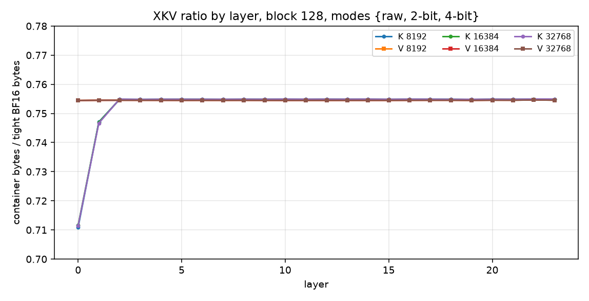
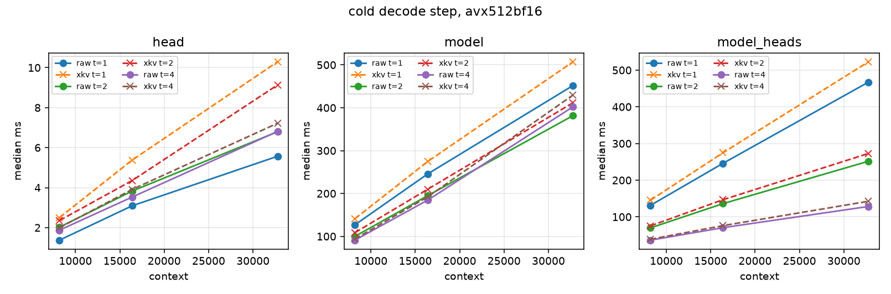
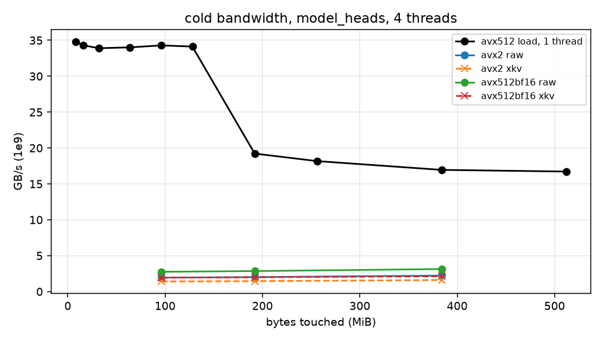

# compressed-kv-attention

Lossless BF16 exponent coding of K and V, decoded inside the QK and online-softmax V loops, so a CPU decode step reads the compressed cache and emits FP32 attention that matches an uncompressed BF16 baseline bit for bit.

## Problem

One decode step reads the whole KV cache. With BF16 elements that traffic is `4 * seq * head_dim` bytes per KV head (K and V). Qwen2.5-0.5B has 24 layers, 2 KV heads, and `head_dim = 64`, so a step reads `seq * 12288` bytes of KV: 96 MiB at 8K, 192 MiB at 16K, 384 MiB at 32K. GQA (Ainslie et al., arXiv:2305.13245) and MLA (DeepSeek-V2, arXiv:2405.04434) cut that factor by changing the model. PagedAttention (Kwon et al., arXiv:2309.06180) removes allocation fragmentation and does not change the bytes of a dense step. KIVI (Liu et al., arXiv:2402.02750) quantizes the cache. Quest (Tang et al., arXiv:2406.10774), vAttention (arXiv:2510.05688), and certified sparse attention (Li, arXiv:2610.24991) drop tokens, with or without an error certificate. SplitZip (Guo and Joshi, arXiv:2605.01708), AdaCode (Li et al., EMNLP 2026), and ExANS (OpenLake blog) are lossless exponent codecs whose decode materializes BF16 before attention or before a transfer.

This repository keeps the BF16 values and the accumulation order, and it folds the exponent decode into the arithmetic so the compressed bytes are the bytes the attention loop loads.

## Data

Model `Qwen/Qwen2.5-0.5B`, revision `060db6499f32faf8b98477b0a26969ef7d8b9987`, loaded with torch 2.14.1+cpu and transformers 5.21.0. Attention implementation reported by the loader: `sdpa`. Config used by the dump: 24 layers, 14 query heads, 2 KV heads, head dimension 64, GQA group 7, every layer `full_attention`. The cache tensors are native `torch.bfloat16`. K is post-RoPE. V is the value projection. Query head `h` reads KV head `h // 7`.

Text is Project Gutenberg ebook 1342, Pride and Prejudice, fetched from `https://www.gutenberg.org/cache/epub/1342/pg1342.txt` (772386 bytes). The tokenizer yields 175904 tokens. The dump is the first 32768, which is the model's maximum position length used here. Prefill is chunked through `model.model(..., use_cache=True)` with a score-tensor budget of 512 MiB. On a 128-token check, full and chunked prefill produced bitwise-equal layer-0 K and layer-0 V in `torch.bfloat16`, and layer-3 K had mean absolute relative difference 0. Queries are the post-RoPE query at positions 8192, 16384, and 32768, taken from `q_proj` plus `apply_rotary_pos_emb` on the last token of the chunk that lands on that position.

Dumps are KVD1 (little-endian `u32` header: magic, version 1, layers, KV heads, query heads, head dim, seq, reserved 0) followed by K then V as `[layers, kv_heads, seq, dim]` `uint16` BF16 bits. The `.qsnap` file is magic `QSN1`, then snapshot count, layers, query heads, the positions, the head dim, and `[n_snap, layers, n_q, dim]` `uint16`. Weights and dumps are not in the git tree. `python/dump_kv.py` and `python/analyze_exponents.py` regenerate them.

## Go / no-go

Rule, fixed before looking at the 8K/16K/32K prefix tables: GO if the per-block minimum of the raw container and the 2-bit and 4-bit coded containers is at most 0.85 of tight BF16 KV bytes. Tight bytes are `2 * seq * dim` per matrix, with no header. The container includes the 8-byte block header. Block length for the decision is the minimizer over {16, 32, 64, 128} under that same rule.

Decision on every prefix of the 32768-token dump: **GO**. Block 128 wins. Ratios below are container/tight.

| seq | K | V | KV | KV escape rate | mean H(exp \| block, dim) | (8+H)/16 |
| ---: | ---: | ---: | ---: | ---: | ---: | ---: |
| 8192 | 0.752669 | 0.754514 | 0.753592 | 0.00310334 | 2.27985 | 0.642491 |
| 16384 | 0.752719 | 0.754512 | 0.753616 | 0.00312752 | 2.27398 | 0.642124 |
| 32768 | 0.752725 | 0.754513 | 0.753619 | 0.00312534 | 2.27132 | 0.641957 |

At 32768 tokens the KV container is 303446974 bytes and the tight BF16 KV image is 402653184 bytes. Full records are `results/entropy_8192.json`, `results/entropy_16384.json`, and `results/entropy_32768.json`.

Sign entropy is about 1 bit and mantissa entropy is about 6.9 bits, on both K and V, so those fields are stored raw. Exponent entropy conditional on the block and the channel is a little above 2 bits. A fixed 4-bit residual cannot reach `(8+H)/16`.

Block-size sweep at 32768, modes {raw, 2-bit, 4-bit}, KV ratio: 16 → 0.783145, 32 → 0.766436, 64 → 0.757880, 128 → 0.753619. Adding a 3-bit mode (not implemented in the kernels) lowers the 128-token-block KV ratio to 0.712120 with escape rate 0.020228.

At block 128 and modes {raw, 2-bit, 4-bit} the 32768-token dump has 12288 blocks per tensor (24 layers × 2 KV heads × 256 blocks). K uses 767 blocks of 2-bit and 11521 of 4-bit. V uses 12288 blocks of 4-bit. Raw mode is unused. Layer 0 K is 512/512 blocks of 2-bit (ratio 0.711455, escape rate 0.082060). Every other measured layer ratio sits between 0.711455 and 0.754929 for K and between 0.754447 and 0.754614 for V.

A clean 4-bit block (`n = 128`, `dim = 64`, zero escapes) is `8 + 64 + 8192 + 4096 = 12360` bytes against a tight 16384, ratio `12360/16384 = 0.75439453125`. The V ratio sits on that figure plus two bytes per escape. A clean 2-bit block is 10312 bytes, ratio 0.629395.

zlib on layer 0 of the 32768-token dump, ratio of compressed size to the raw BF16 bytes: K level 1 = 0.712136, level 6 = 0.685110; V level 1 = 0.433807, level 6 = 0.407079. V has cross-element redundancy that this exponent code does not capture. That is outside the kernel format.



## Encoding

A tensor is `[seq, dim]` BF16, token-major, packed as a sequence of blocks with no outer header and no inter-block padding. `dim` is a multiple of 4, at most 256. `block_tokens` is at most 255 and `block_tokens * dim <= 65535`. The kernels use `block_tokens = 128`. The last block may be short.

BF16 layout is sign 1, exponent 8, mantissa 7. The sign/mantissa byte is `((bits >> 8) & 0x80) | (bits & 0x7F)`. Reconstruction is `((sm & 0x80) << 8) | (exp << 7) | (sm & 0x7F)`. Widening to FP32 is a left shift of the 16-bit pattern by 16.

Block header, little-endian:

| offset | type | field |
| ---: | --- | --- |
| 0 | u8 | mode: 0 raw, 2, or 4 |
| 1 | u8 | `n_tokens` |
| 2 | u16 | `n_escape` (0 in raw mode) |
| 4 | u16 | `head_dim` |
| 6 | u16 | reserved 0 |

Raw payload: `n_tokens * head_dim` little-endian BF16 words, token-major.

Coded payload, in order:

1. `u8 base[head_dim]`
2. `u8 sm[n_tokens * head_dim]`
3. packed residuals, `bits` per element, first element in the low bits of the first byte
4. `u16 escape[n_escape]`, full BF16 words, scan order

4-bit packing: byte `j` holds element `2j` in bits 3:0 and element `2j+1` in bits 7:4. 2-bit packing: byte `j` holds elements `4j+0` through `4j+3` in bit pairs starting at bit 0. The all-ones code (15 or 3) is the escape sentinel. A non-sentinel code `c` means exponent `base[d] + c`.

For a dimension, the base is the smallest exponent that maximises the number of values whose exponent lies in `[base, base + 2^bits - 2]`. Ties keep the smallest base. Each block independently picks the mode with the smallest container. Ties prefer raw, then fewer escapes, then fewer bits. Container sizes:

- raw: `8 + 2 * n * dim`
- coded: `8 + dim + n * dim + ceil(n * dim * bits / 8) + 2 * n_escape`

`encode_bf16` / `decode_bf16` implement this. The Python sizer in `analyze_exponents.py` uses the same byte formula. On all three prefixes the C++ container byte count equals the Python sizer: 75859016, 151722900, and 303446974.

## Kernels

`attention_decode` runs one decode step for `n_q` queries that share one KV head. Q, K, and V are BF16. The output is FP32. The caller passes either raw K and V or two XKV blobs, not both.

Scalar and AVX2 require `dim % 8 == 0`. Eight lanes start at 0. For `d = 0, 8, 16, ...` each lane is `fmaf(q[d+j], k[d+j], lane[j])` after widening BF16 to FP32. The score is `((lane0+lane4)+(lane1+lane5)) + ((lane2+lane6)+(lane3+lane7))`, which is `_mm_hadd_ps` twice on the sum of the 128-bit halves. AVX2 loads eight raw BF16 values with a zero-extend and a 16-bit left shift. The 4-bit path unpacks eight nibbles, adds the per-channel base, merges sign and mantissa, and widens, all in YMM registers. An escape lane is corrected from the escape pointer through an 8-wide stack temporary. The 2-bit path gathers eight codes and widens them through the same 8-wide temporary. Neither path writes an expanded KV tensor.

AVX-512 BF16 requires `dim % 32 == 0` and `VDPBF16PS`. Each QK step consumes 32 BF16 values. The score is a pairwise tree over the 16 FP32 lanes: four groups of four, then two, then one. V is widened to FP32 and updated 16-wide as `acc = fmaf(e, v, acc * alpha)`. AVX-512 matches the AVX-512 raw kernel. It does not match the scalar score tree. `_mm512_extractf32x8_ps` is not used, so the TU does not require AVX-512DQ.

Online softmax, shared by every backend:

```
m' = max(m, score)
alpha = exp(m - m')
e = exp(score - m')
l = fmaf(l, alpha, e)
acc[d] = fmaf(e, v[d], acc[d] * alpha)
out = acc * (1/l)
```

The initial state is `m = -inf`, `l = 0`, `acc = 0`. The first finite score yields `alpha = 0` and `e = 1` under IEEE evaluation of `exp(-inf)`.

`n_threads` splits the sequence on `split_tokens` boundaries. For XKV that split must be the encode block size (the tail block may be short). Thread-local states fold in thread order:

```
m = max(m1, m2)
e1 = exp(m1 - m)
e2 = exp(m2 - m)
l = fmaf(l1, e1, l2 * e2)
acc = fmaf(acc1, e1, acc2 * e2)
```

An empty tile (`m = -inf`, `l = 0`, `acc = 0`) folds into a finite tile as a zero contribution. Two `-inf` states are not folded; `seq > 0` is required. Compressed and raw outputs match for the same backend, thread count, and split. Single-thread and multi-thread outputs are different association orders and are not required to match each other.

Translation units are compiled with `-ffp-contract=off -fno-fast-math`. The process MXCSR is unchanged. On this Linux x86-64 host the ABI default sets FTZ and DAZ (`0x1F80`). CPUID gates AVX2 (leaf 7 EBX bit 5, plus XCR0 YMM) and AVX-512 BF16 (AVX512F, AVX512BW, AVX512VL, leaf 7 subleaf 1 EAX bit 5, plus XCR0 bits for ZMM and opmask).

OpenMP is the only thread runtime. `omp_set_dynamic(0)` is set before a parallel region, and the dispatch throws if the runtime starts fewer threads than requested.

## Roofline

Per KV head, with `G` queries of dimension `D` over `S` tokens, the QK and PV FMAs are `4 * D * S * G` flops. Softmax `exp` and the horizontal add are not in that count. Fused GQA reads K and V once, `4 * D * S` bytes, so the arithmetic intensity on the KV stream is `G` flop/byte. Here `G = 7`. One query head would be 1 flop/byte. Q and the FP32 output are negligible next to K and V at these lengths.

GFLOP/s uses 1e9 flops. GB/s uses 1e9 bytes. FP32 peak is eight independent `vfmadd231ps` chains, each lane counted as 2 flops, written as inline asm so a constant-operand FMA is not strength-reduced to an add. `VDPBF16PS` peak uses the same shape and counts 64 flops per instruction (32 products and 32 adds). Read bandwidth is a scalar `uint64` sum and an AVX-512 load (`vmovdqa64`) or non-temporal load (`vmovntdqa`), median of five passes after one warmup. Numbers are from `results/bench.json`.

| threads | AVX2 FP32 FMADD | AVX-512 FP32 FMADD | AVX-512 VDPBF16PS |
| ---: | ---: | ---: | ---: |
| 1 | 121.12 | 233.24 | 116.35 |
| 2 | 233.07 | 500.57 | 233.65 |
| 4 | 452.95 | 864.45 | 456.86 |

One-thread AVX-512 load GB/s by buffer size: 8 MiB 34.83, 128 MiB 34.13, 192 MiB 19.22, 256 MiB 18.17, 512 MiB 16.72. The same 512 MiB buffer with 4 threads reaches 65.02 GB/s (load) and 61.84 GB/s (non-temporal). Scalar 512 MiB, one thread, is 8.27 GB/s.

At 32768 tokens, `model_heads`, AVX-512 BF16, 4 threads, cold, the raw kernel does `4 * 64 * 32768 * 14 * 24 = 2818572288` QK+PV flops in 128.402 ms, which is 21.95 GFLOP/s. That is 2.5% of the 4-thread AVX-512 FP32 peak (864.45 GFLOP/s). The same call moves 402653184 tight BF16 bytes in that time, 3.14 GB/s, which is 4.8% of the 4-thread 512 MiB load (65.02 GB/s). Arithmetic intensity on that call is 7 flop/byte. The XKV call moves 303446974 container bytes in 142.531 ms, 2.13 GB/s. Hot and cold raw medians at this point are 128.422 ms and 128.402 ms, so a 512 MiB eviction between samples does not move the result. The loop is not sitting on either roof.

A 4-bit block replaces 2 BF16 bytes with 1 sign/mantissa byte plus 0.5 residual bytes, plus the base and the header. The nibble unpack is several SIMD instructions per eight or 32 elements. When the working set fits in L2, or when `G = 7` already supplies several flops per KV byte, that extra work can dominate the byte reduction. The tables in the next section are the measurement of that tradeoff. They are not a claim that the kernel is DRAM-bound at every point.

## Results

Host: KVM guest, 4 vCPU, `Intel(R) Xeon(R) Processor`, family 6 model 207 stepping 2, BogoMIPS 4800.00. Flags include AVX2, AVX-512F, AVX-512DQ, AVX-512BW, AVX-512VL, and AVX512_BF16. Cache descriptors from `cpu0`: L1 data 48K, L1 instruction 32K, L2 unified 2048K, L3 unified 327680K shared across cpu 0-3. `lscpu` reports the same hierarchy as 192 KiB L1d, 128 KiB L1i, 8 MiB L2, and 320 MiB L3. MemTotal at measurement time is in `results/bench.json`. The L3 figure is the CPUID leaf exposed to the guest. The read sweep is the bandwidth evidence: one-thread AVX-512 loads run from 33.90 to 34.83 GB/s for buffers of 8 MiB through 128 MiB, then 19.22 GB/s at 192 MiB and 16.72 GB/s at 512 MiB.

Benchmark: `kvexp_bench` on the 32768-token dump and its query snapshots. Prefixes 8192, 16384, and 32768. Each configuration `memcmp`s raw and XKV FP32 outputs before timing. Timing is two untimed calls, then the median of at least five samples, stopping at 25 samples or at 350 ms of accumulated sample time. `cold = 1` reads a 512 MiB buffer between samples. `raw_ms` / `xkv_ms` in the JSON are those medians. `raw_gbps_tight` divides tight BF16 K+V bytes by seconds. `xkv_gbps_container` divides XKV container bytes by seconds. `steps_per_s` is `1000 / median_ms` for one attention call of the stated scope.

Scopes:

- `head`: layer 0, KV head 0, its 7 query heads, sequence-parallel.
- `model`: all 24×2 KV heads in series, each sequence-parallel.
- `model_heads`: OpenMP over the 48 KV heads, each head single-threaded.

Backends: AVX2 and AVX-512 BF16. Threads 1, 2, and 4.

Cold median milliseconds, and the XKV/raw ratio of those medians. `steps/s` is `1000/ms` for one call of that scope. Thread 2, the hot series, and the per-sample min/max are in the JSON.

`model_heads`, the full model with one thread per KV head:

| backend | seq | threads | raw ms | xkv ms | xkv/raw | raw steps/s | xkv steps/s |
| --- | ---: | ---: | ---: | ---: | ---: | ---: | ---: |
| avx512bf16 | 8192 | 1 | 131.214 | 145.177 | 1.106 | 7.621 | 6.888 |
| avx512bf16 | 8192 | 4 | 36.546 | 38.988 | 1.067 | 27.362 | 25.649 |
| avx512bf16 | 16384 | 1 | 246.051 | 274.869 | 1.117 | 4.064 | 3.638 |
| avx512bf16 | 16384 | 4 | 70.567 | 76.202 | 1.080 | 14.171 | 13.123 |
| avx512bf16 | 32768 | 1 | 467.400 | 522.768 | 1.118 | 2.139 | 1.913 |
| avx512bf16 | 32768 | 4 | 128.402 | 142.531 | 1.110 | 7.788 | 7.016 |
| avx2 | 8192 | 1 | 184.407 | 195.940 | 1.063 | 5.423 | 5.104 |
| avx2 | 8192 | 4 | 52.006 | 54.125 | 1.041 | 19.228 | 18.476 |
| avx2 | 16384 | 1 | 344.886 | 370.746 | 1.075 | 2.899 | 2.697 |
| avx2 | 16384 | 4 | 99.982 | 104.618 | 1.046 | 10.002 | 9.559 |
| avx2 | 32768 | 1 | 628.332 | 678.892 | 1.080 | 1.592 | 1.473 |
| avx2 | 32768 | 4 | 180.954 | 189.123 | 1.045 | 5.526 | 5.287 |

`head`, layer 0 KV head 0 and its 7 queries, sequence-parallel. This working set is `seq * 64 * 4` bytes (2 MiB at 8K, 8 MiB at 32K).

| backend | seq | threads | raw ms | xkv ms | xkv/raw |
| --- | ---: | ---: | ---: | ---: | ---: |
| avx512bf16 | 8192 | 1 | 1.373 | 2.499 | 1.820 |
| avx512bf16 | 8192 | 4 | 1.873 | 1.998 | 1.067 |
| avx512bf16 | 16384 | 1 | 3.092 | 5.378 | 1.740 |
| avx512bf16 | 16384 | 4 | 3.528 | 3.910 | 1.108 |
| avx512bf16 | 32768 | 1 | 5.569 | 10.293 | 1.848 |
| avx512bf16 | 32768 | 4 | 6.812 | 7.220 | 1.060 |
| avx2 | 8192 | 1 | 1.722 | 3.005 | 1.745 |
| avx2 | 8192 | 4 | 2.118 | 2.012 | 0.950 |
| avx2 | 16384 | 1 | 3.904 | 6.595 | 1.689 |
| avx2 | 16384 | 4 | 3.752 | 3.605 | 0.961 |
| avx2 | 32768 | 1 | 6.765 | 11.845 | 1.751 |
| avx2 | 32768 | 4 | 7.127 | 7.529 | 1.056 |

`model`, heads in series, 4 threads, cold, XKV/raw median: AVX-512 1.030, 1.041, 1.068 and AVX2 0.998, 1.001, 1.008 at 8192, 16384, 32768.

On every `model_heads` row the XKV median is slower. The three medians below 1.0 are AVX2 `head` at 4 threads for 8192 and 16384, and AVX2 `model` at 4 threads for 8192. Their sample ranges overlap the raw ranges (AVX2 `head` 8192 raw 2.028-6.986 ms over 25 samples, xkv 1.926-2.131; AVX2 `model` 8192 raw 96.737-98.537, xkv 96.608-97.285). At 32768, `model_heads`, AVX-512, 4 threads, the cold XKV samples span 139.552-178.418 ms around the median 142.531, while raw spans 128.215-130.117.

The nibble unpack costs more than the bytes it removes. A 4-bit block is 0.754 of the tight BF16 image, and the full-model step is slower by 4% to 11% at 4 threads. The single-thread single-head AVX-512 step at 32768 is 1.85× the raw median (5.569 ms vs 10.293 ms).





C++ container byte counts equal the Python sizer on all three prefixes (75859016, 151722900, 303446974). Encode of all layers and both KV heads took 0.540 s, 1.003 s, and 2.092 s at 8192, 16384, and 32768.

Bit identity on this dump: all 108 timed configurations passed `memcmp` of the raw and XKV FP32 outputs before the timer, including both backends, threads 1, 2, and 4, hot and cold, and all three scopes. The unit tests cover the same predicate on synthetic blocks with zeros, subnormals, infinities, NaNs, escapes, `dim` in {16, 32, 64}, group sizes 1, 3, and 7, and a tail that is not a full block.

## Limitations

The fixed-rate code stores an 8-bit sign/mantissa byte and a 4-bit residual on almost every V element. Conditional exponent entropy near 2.27 bits says an entropy coder could do better. zlib on layer-0 V reaches about 0.41, which is cross-element structure this format ignores. A 3-bit residual was measured and not implemented.

Escape lanes and the 2-bit unpack spill a decoded fragment to a stack temporary the size of one SIMD chunk. They do not allocate or write a decoded KV matrix.

AVX-512 scores use `VDPBF16PS` and a 16-lane pairwise sum. Scalar and AVX2 use an 8-lane FMA and `_mm_hadd_ps`. Those two scores differ. The bit-identity claim is per backend.

Multi-thread folding is a second association. It matches raw vs XKV at that thread count. It does not match the single-thread result.

FTZ/DAZ follow the Linux ABI default. A host with a different MXCSR will still match raw vs XKV, and will not match a flush-to-nearest run.

The read sweep is one thread except for the extra 512 MiB points at 2 and 4 threads. It is a load-and-add, not a STREAM triad copy. Quoted GB/s are 1e9 bytes per second.

The attention benchmark is one prefill document and one model. It is the decode-step kernel on a dumped cache, not a full generate loop with the rest of the transformer.

## Build

C++20, CMake ≥ 3.20, OpenMP. AVX2 and AVX-512 objects carry their own `-m` flags. There is no LTO, so those ISA flags stay on the translation unit that uses them.

```
cmake -S . -B build -DCMAKE_BUILD_TYPE=Release -DCMAKE_CXX_COMPILER=g++
cmake --build build -j
./build/kvexp_tests
./build/kvexp_bench --dump model.kvdump --qsnap model.qsnap --out results/bench.json
```

`KVEXP_SANITIZER=ON` adds AddressSanitizer and UndefinedBehaviorSanitizer. Clang on an image whose `libstdc++.so` lives only in the GCC directory is pointed at `g++ -print-file-name=libstdc++.so` before the compiler probe. GitHub Actions builds GCC and Clang, Release and Debug+sanitizers. AVX-512 tests run only when `detect_cpu` reports AVX-512 BF16.

Python dependencies for the entropy report and the figures are in `python/requirements.txt`. The dump script additionally needs `python/requirements-dump.txt`.

```
python python/plot_results.py \
  --bench results/bench.json \
  --entropy results/entropy_8192.json results/entropy_16384.json results/entropy_32768.json \
  --outdir docs/figures
```

## Prior work

- Joshua Ainslie, James Lee-Thorp, Michiel de Jong, Yury Zemlyanskiy, Federico Lebrón, and Sumit Sanghai. GQA: Training Generalized Multi-Query Transformer Models from Multi-Head Checkpoints. arXiv:2305.13245. Fewer KV heads, which requires training or uptraining.
- DeepSeek-AI. DeepSeek-V2: A Strong, Economical, and Efficient Mixture-of-Experts Language Model. arXiv:2405.04434. Multi-head Latent Attention compresses K and V into a latent the model is trained to use.
- Woosuk Kwon, Zhuohan Li, Siyuan Zhuang, Ying Sheng, Lianmin Zheng, Cody Hao Yu, Joseph E. Gonzalez, Hao Zhang, and Ion Stoica. Efficient Memory Management for Large Language Model Serving with PagedAttention. arXiv:2309.06180. Paging for KV allocation.
- Zirui Liu, Jiayi Yuan, Hongye Jin, Shaochen Zhong, Zhaozhuo Xu, Vladimir Braverman, Beidi Chen, and Xia Hu. KIVI: A Tuning-Free Asymmetric 2bit Quantization for KV Cache. arXiv:2402.02750. Lossy per-channel key and per-token value quantization.
- Jiaming Tang, Yilong Zhao, Kan Zhu, Guangxuan Xiao, Baris Kasikci, and Song Han. Quest: Query-Aware Sparsity for Efficient Long-Context LLM Inference. arXiv:2406.10774. Page-level approximate top-k.
- vAttention: Verified Sparse Attention. arXiv:2510.05688. Sparse attention with a user tolerance.
- Runguo Li. Certified Sparse Attention via Perturbed Retrieval. arXiv:2610.24991. Per-query error certificates for sparse attention. The abstract reports a CPU decode speedup against dense attention on a 16-bit cache; that method skips values.
- Yipin Guo and Siddharth Joshi. SplitZip: Ultra Fast Lossless KV Compression for Disaggregated LLM Serving. arXiv:2605.01708. Fixed 4-bit exponent codebook plus an escape stream, decompressed before the cache is consumed. The abstract reports GPU codec throughput and a transfer speedup.
- Changshi Li, Peiyu Liu, Liang Chen, Yuyao Zhai, and Jerry Zhijian Yang. AdaCode: Adaptive Lossless Compression for BFloat16 KV Cache. EMNLP 2026, pages 6112-6130. The abstract reports a 71.78% average compression ratio on LLMs and bit-exact recovery. Decompression precedes use.
- ExANS: Exponent Aligned Asymmetric Numeral Systems. https://openlakehq.com/blog/exans-lossless-gpu-compression-for-bf16-kv-cache. The blog's position-aligned H100 row is 1.5154× and 622.1 GB/s median decode. The decoded tensor is the KV cache the engine reads.

## License

MIT. See `LICENSE`.
